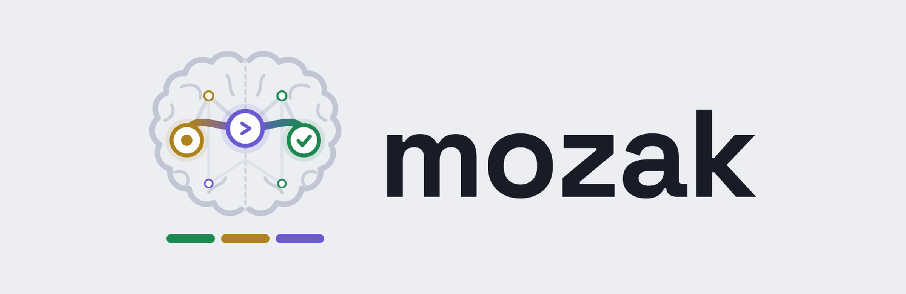

<div align="center">



**One approved plan per project, shared by your coding agents, visible in Obsidian.**

You work in ideas and plans, not code. Several agents share one plan without overwriting each other, and you follow their progress from your notes.

[](https://github.com/pitfa19/mozak/actions/workflows/ci.yml)
[](LICENSE)
[](docs/installation.md)
[](docs/installation.md)

[What it is](#what-it-is) · [See it run](#see-it-run) · [Install](#install) · [How it works](#how-it-works) · [Obsidian](#see-everything-in-obsidian) · [Safety](#safety) · [Tested](#what-is-tested-and-what-is-not) · [Docs](docs/installation.md)

</div>

---

## See it run

<div align="center">
<a href="https://github.com/pitfa19/mozak/releases/download/readme-assets/mozak-demo.mp4"></a>
</div>

The preview plays at double speed. In 76 seconds: you ask your agent in plain words, it reads the project and asks one question, drafts a plan and waits for your yes, records the test result, and the roadmap in Obsidian moves forward. The Obsidian side is a live capture of the plugin redrawing from the files. The terminal side is a rendered reenactment of the agent chat, with the same mozak commands run on disk. Click it for the [full video with sound](https://github.com/pitfa19/mozak/releases/download/readme-assets/mozak-demo.mp4).

## What it is

**mozak gives every project one shared plan, stored as plain files in the project folder (or in your notes, for public repos).** It does two jobs:

- **Agents read the same plan.** Agents that load the mozak skill or MCP server start from the same plan, so you don't have to paste the context into each one. Agents propose changes, but nothing becomes the plan until you approve it.
- **You follow it from Obsidian.** Every project's plan shows up in your vault with a roadmap and progress, so parallel work is visible in one place. You approve the next step. An outcome turns green when an agent records passing evidence, such as a test run it reports. mozak does not run the tests itself, and outcomes you mark as yours also need your sign-off.

Why you can trust it:

- **It is just files.** `mozak.json` holds the plan, `mozak.md` is a readable copy. They sit next to your `README.md`, and if the folder is in git, git keeps the history. No cloud, no account, no daemon.
- **You stay in charge.** Agreeing on *what* to do and agreeing to *start building* are two separate approvals.
- **Many agents, no mess.** A write made through mozak from an out-of-date copy is refused instead of overwriting someone else's work.
- **Repos and notes together.** A project can be a local folder, an Obsidian vault folder, or a GitHub repo you have not even cloned.

It is for developers and researchers who already use coding agents and want them to share one plan. It works with any agent that can load a skill or an MCP server. Checked so far: jcode (skill and MCP) and Claude Code (MCP).

## Install

You need Node 24.11 or newer (Node 26 works) and Git. Linux and macOS.

```bash
npm install -g mozak
mozak doctor --fix      # links the mozak skill into ~/.claude/skills, ~/.jcode/skills or ~/.codex/skills if they exist
```

The npm package bundles the CLI and the MCP server in one package with no dependencies and no install scripts. Update with `npm install -g mozak@latest`.

Connect your agent to the MCP server (use your own inventory path):

```bash
# Claude Code
claude mcp add mozak -- mozak-mcp --config "$HOME/notes/mozak-inventory.json"
# Codex
codex mcp add mozak -- mozak-mcp --config "$HOME/notes/mozak-inventory.json"
```

Any other MCP client: command `mozak-mcp`, arguments `--config /path/to/mozak-inventory.json`.

`mozak scopes` and the Obsidian sidebar tell you when a new release is out (`MOZAK_NO_UPDATE_CHECK=1` turns that off). Changes are listed in [CHANGELOG.md](CHANGELOG.md).

<details>
<summary>Install from source instead (portable install, no npm registry)</summary>

```bash
git clone https://github.com/pitfa19/mozak.git && cd mozak
npm ci --ignore-scripts && npm run build
mkdir -p "$HOME/.local/share"
node scripts/install.mjs --prefix "$(cd "$HOME/.local/share" && pwd -P)/mozak" --json
"$HOME/.local/share/mozak/bin/mozak" --help
```

The installer copies a self-contained build into that folder. It uses no `sudo`, makes no network calls and does not touch your shell profile. Add `--check` to preview first. Two commands keep a source install working:

```bash
mozak upgrade --vault ~/Documents/notes   # newest tagged release; the old install is kept, plugin updated in that vault
mozak doctor --fix                        # checks the whole setup; fixes links, wrappers and plugin copies, prints the rest
```

</details>

Details, exit codes, recovery and known limits: [docs/installation.md](docs/installation.md).

## How it works

**1. List your projects.** One `mozak-inventory.json` names every project mozak may look at. Scope commands only touch projects listed there. Keep it at the top of your notes folder, so the Obsidian plugin finds it on its own.

```json
{
  "format": "mozak.local/v3",
  "scopes": [
    { "id": "my-app",     "root": "./my-app" },
    { "id": "lab-notes",  "root": "./vault/lab-notes" },
    { "id": "genome-mcp", "remote": "github:you/genome-mcp", "ref": "main" },
    { "id": "my-oss-tool", "remote": "github:you/my-oss-tool", "plans": "./vault/my-oss-tool" }
  ]
}
```

A project with `root` is a local folder. A project with `remote` is a GitHub repo. Where its plans live depends on who should see them:

- **Private repo**: plans live inside the repo, so everyone with access shares them. mozak checks out only `README.md`, `AGENTS.md` and the two mozak files (a sparse, shallow clone) and pushes plan changes back.
- **Public repo**: add `"plans"` with a folder, usually in your notes. Plans stay there, private to you, and are never committed to the repo. mozak refuses writes once it sees that a repo holding plans has become public (checked at most once a day, and an unreachable API never blocks).

`mozak pull --into ~/Downloads/x` clones the code anywhere. For a public repo the clone never receives plan files. Run mozak read commands inside any clone without `--scope` and it finds the project from the clone's git origin.

**2. Start a project.** Give the folder a `README.md` and an `AGENTS.md`, then ask your agent to set it up with the mozak skill, or run `mozak scope init` yourself (see the skill's `references/bootstrap.md`). This creates the project's `mozak.json` and `mozak.md`. Creating a project is an owner command: agents cannot do it over MCP.

**3. Agree on a plan.**

1. **Propose.** An agent drafts a plan. It waits as *awaiting approval*.
2. **Approve the direction.** You say yes to *what*. This starts planning, not coding.
3. **Approve the build.** A spec is attached and you approve implementation separately.
4. **Remember.** Decisions and evidence are saved into the project's files, so the next session can read where the last one stopped.

**4. Let agents find their way.** `mozak scopes` lists every project with its plan counts. Agents get the same list from the MCP server.

## See everything in Obsidian

The Obsidian plugin in [`packages/obsidian`](packages/obsidian) shows every project from your inventory in the sidebar, notes and GitHub repos alike. Filter by **All**, **Open** or **Done**. Open plans show a small progress strip, one segment per outcome. Click a plan to open its section in the scope's `mozak.md`, which reads like a note: purpose, a roadmap of the outcomes with the current stop, a status table and the full plan text. The sidebar is for reading and navigating. You approve plans in your agent chat, not in Obsidian. The plugin never approves or changes a plan. It may regenerate a stale `mozak.md`, the same as `mozak render`.

Install it from Obsidian: **Settings, Community plugins, Browse**, search for **mozak**, then Install and Enable ([directory page](https://community.obsidian.md/plugins/mozak)). From a source checkout you can also run:

```bash
node scripts/install-obsidian-plugin.mjs /path/to/your/vault --build
```

The plugin finds `mozak-inventory.json` by searching upward from the vault folder, or you can set its path in the plugin settings. Each GitHub project shows a globe or lock badge for a public or private repo.

**Plugin disclosures (desktop-only, `isDesktopOnly: true`):** When your `mozak-inventory.json` lists scopes outside the current vault, the plugin reads their `mozak.json`, `mozak.md`, `README.md` and `AGENTS.md` files from those configured paths and watches them when **Auto-refresh** is enabled. It never scans folders not listed in your inventory and never approves or changes a plan (it may regenerate a stale `mozak.md` projection when there are no unmerged hand edits). For remote GitHub scopes (`"remote": "github:owner/repo"` without vault-hosted `"plans"`), clicking **Sync remote scopes** or enabling **Repo sync interval (seconds)** runs your local `git` with your existing git login on the hidden `.mozak-cache` copy: `git fetch`, then a reset of that copy to the fetched commit. If an earlier mozak write left a plan commit unpushed (for example after a network failure), the sync first commits and pushes that pending `mozak.json` / `mozak.md` change. Set the sync interval to `0` to turn background git activity off. The sync also asks the public GitHub API, without a login and at most once a day per repo, whether each remote repo is public. The update notice only reads a cache file the CLI writes. The plugin never installs or updates itself, and has no telemetry. See [`packages/obsidian/README.md`](packages/obsidian/README.md#disclosures-obsidian-community-plugin-policy) for the full disclosure list.

## Under the hood

<div align="center">
<a href="https://github.com/pitfa19/mozak/releases/download/readme-assets/mozak-under-the-hood.mp4"></a>
</div>

The agent writes plain `mozak.json` and `mozak.md` files in your project folder. The Obsidian sidebar and the roadmap diagram inside each note are drawn from those files. The agent writes no UI code.

## Use it with your agent

| You want | Use |
| --- | --- |
| See every project and where it lives | `mozak scopes`, or the `mozak_scopes` MCP tool |
| Read one project's plan | `mozak context`, `mozak plans`, `mozak check` |
| Refresh GitHub projects now | `mozak sync` |
| Let any MCP agent read and propose | `mozak-mcp --config mozak-inventory.json` |
| Run the guided planning conversation | the installed skill at `PREFIX/skills/mozak/SKILL.md` |
| Rename a project (owner) | `mozak scope retitle` |
| Move pre-0.4 `MOZAK.json` / `MOZAK.md` to lowercase (owner) | `mozak rename-files --all` |

Every scope command needs an explicit `--config`. Only the maintenance commands (`upgrade`, `doctor`) run without one.

## Safety

- **Bound approvals.** An approval is tied to the exact plan version you were shown, and one message cannot be reused for a second approval. Agents over MCP cannot approve at all. The skill tells agents to accept only your own message, not quotes or tool output, but mozak cannot verify who typed it (see the limits below).
- **No overwrites.** A write through mozak based on an out-of-date copy is refused. Hand edits to the files are not guarded.
- **Small pushes.** For private GitHub projects, mozak commits and pushes only `mozak.json` and `mozak.md`. For public repos with plans in your notes it never commits or pushes.
- **No credentials.** mozak never asks for or stores them. GitHub access uses your existing git login.
- **Honest limits.** Approval follows a trusted-host convention, it is not authentication: an agent with shell access could run the owner commands. Concurrency guarantees cover cooperating processes on a local disk, not network drives, power loss or sync tools editing the same files. Remote scopes follow one branch.

## What is tested and what is not

**Tested.** 447 unit and integration tests plus 70 installer tests, run in CI on Ubuntu and macOS with Node 24.11 and 26 on every push to `main` and every pull request. They cover:

- stale writes refused, including two real CLI processes writing at once
- a write killed mid-way recovering without losing data
- the two approvals kept separate and bound to the version you saw
- agents over MCP unable to approve or create projects
- public repos never receiving plan commits
- the installer refusing unsafe targets without writing anything

The Obsidian plugin passed Obsidian's automated community review. Its build and attestation are checked on every release.

**Not proven yet.**

- **A benefit for agents.** A small pilot (5 proxy tasks, 10 agent sessions) compared agents with and without mozak and found no significant difference in token use: one group did 16% worse, the other 6% better. A larger evaluation is planned. Until then, treat mozak as a way to keep one approved plan and see it in Obsidian, not as a proven speed-up.
- **Agent hosts.** Checked: jcode loading the skill and the MCP server, and Claude Code 2.1 calling the MCP server from the npm package. Codex and other MCP clients have not been verified yet.
- **The plugin inside Obsidian.** Its view model is unit-tested and it has been tried by hand, but there are no automated tests running inside the Obsidian app.
- **Real GitHub.** Tests use local bare repos. Real GitHub was checked by hand.
- **Unsupported setups.** Windows, network filesystems and diverged remote branches.

## Platforms

Linux and macOS, Node 24.11 or newer.

## Contributing

```bash
npm ci --ignore-scripts && npm run build
npm test && npm run test:install
```

Run the tests before opening a pull request. If your global git config adds hooks or signing, run them with `GIT_CONFIG_GLOBAL=/dev/null`. The format, remote scopes, exit codes and known limits are in [docs/installation.md](docs/installation.md).

## License

MIT. See [LICENSE](LICENSE).
