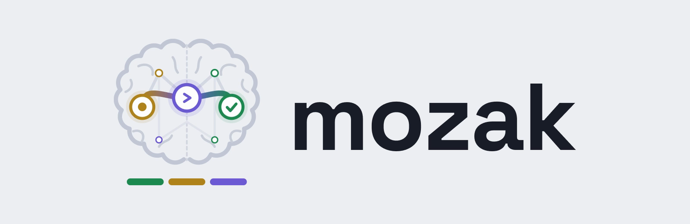

<div align="center">



**One approved plan per project, shared by your coding agents, visible in Obsidian.**

You work in ideas and plans, not code. Several agents share one plan without overwriting each other, and you follow their progress from your notes.

[](https://github.com/pitfa19/mozak/actions/workflows/ci.yml)
[](LICENSE)
[](docs/installation.md)
[](docs/installation.md)

[What it is](#the-problem) · [Example](#a-short-example) · [See it run](#see-it-run) · [Install](#install) · [How it works](#how-it-works) · [Obsidian](#see-everything-in-obsidian) · [Safety](#safety) · [Tested](#what-is-tested-and-what-is-not) · [Docs](docs/installation.md)

</div>

---

## The problem

Coding agents forget the plan between sessions, so you explain the project again. When several agents work at once, one can overwrite what another just wrote. And an agent can start building before you agreed on what to build.

mozak fixes this with plain files:

- **Every agent reads the same plan.** `mozak.json` holds it and `mozak.md` is a readable copy. You never explain the project twice.
- **Agents propose, you decide.** Agreeing on *what* to do and agreeing to *start building* are two separate yeses.
- **Stale writes are refused.** An agent that writes from an old copy gets `stale-input` and must reread. Nothing is overwritten.
- **One view across all your projects.** The Obsidian plugin shows every project's plans and progress in one sidebar, with a Focus tab for the plans you starred.

No cloud, no account, no background service.

```bash
npm install -g mozak && mozak doctor --fix
```

## A short example

Two agents read the same plan, then both propose at once. The first write lands. The second is refused because its copy is now old, so it cannot overwrite the first. This is real output: `node scripts/readme-example.mjs` reproduces it on a throwaway scope after `npm run build`.

```text
$ mozak plan propose --scope my-app --request a.json   # agent A proposes
status: ok
committed: true
(exit 0)

$ mozak plan propose --scope my-app --request b.json   # agent B proposes from the same, now old, snapshot
status: stale-input
committed: false
stale-input: snapshot changed; reread before submitting a new operation: take the new snapshot from context as expected and use a new operationId
(exit 3)

$ mozak plans --scope my-app   # what is in the plan now
awaiting (1)
  - Add dark mode  [dark-mode]
      review: direction approval
      outcome: The app has a dark theme
```

The plan is now waiting for your yes. Agent B rereads and proposes again from the new snapshot.

## See it run

<div align="center">
<a href="https://github.com/pitfa19/mozak/releases/download/readme-assets/mozak-demo.mp4"></a>
</div>

The preview plays at double speed. In 76 seconds: you ask your agent in plain words, it reads the project and asks one question, drafts a plan and waits for your yes, records the test result, and the roadmap in Obsidian moves forward. The Obsidian side is a live capture of the plugin redrawing from the files. The terminal side is a rendered reenactment of the agent chat, with the same mozak commands run on disk. Click it for the [full video with sound](https://github.com/pitfa19/mozak/releases/download/readme-assets/mozak-demo.mp4).

## What it is

**mozak gives every project one shared plan, stored as plain files in a folder of your Obsidian vault.** It does two jobs:

- **Agents read the same plan.** Agents that load the mozak skill or MCP server start from the same plan, so you don't have to paste the context into each one. Agents propose changes, but nothing becomes the plan until you approve it.
- **You follow it from Obsidian.** Every project's plan shows up in your vault with a roadmap and progress, so parallel work is visible in one place. You approve the next step. An outcome turns green when an agent records passing evidence, such as a test run it reports. mozak does not run the tests itself, and outcomes you mark as yours also need your sign-off.

Why you can trust it:

- **It is just files.** `mozak.json` holds the plan, `mozak.md` is a readable copy. They sit next to the project's `README.md` in your vault, and if the vault is in git, git keeps the history. No cloud, no account, no daemon.
- **You stay in charge.** Agreeing on *what* to do and agreeing to *start building* are two separate approvals.
- **Many agents, no mess.** A write made through mozak from an out-of-date copy is refused instead of overwriting someone else's work.
- **Your notes, not your code repos.** Plans live only in your vaults, so a public code repo never carries them. A project can link to its code repo for one-click access, and mozak never fetches it.

It is for developers and researchers who already use coding agents and want them to share one plan. It works with any agent that can load a skill or an MCP server. Checked so far: jcode (skill and MCP) and Claude Code (MCP).

## Install

You need Node 24.11 or newer (Node 26 works) and Git. Linux and macOS.

```bash
npm install -g mozak
mozak doctor --fix      # links the mozak skill into ~/.claude/skills, ~/.jcode/skills or ~/.codex/skills if they exist
```

The npm package bundles the CLI and the MCP server in one package with no dependencies and no install scripts. Update with `npm install -g mozak@latest`.

Connect your agent to the MCP server (use your own inventory path):

```bash
# Claude Code
claude mcp add mozak -- mozak-mcp --config "$HOME/notes/mozak-inventory.json"
# Codex
codex mcp add mozak -- mozak-mcp --config "$HOME/notes/mozak-inventory.json"
```

Any other MCP client: command `mozak-mcp`, arguments `--config /path/to/mozak-inventory.json`.

`mozak scopes` and the Obsidian sidebar tell you when a new release is out (`MOZAK_NO_UPDATE_CHECK=1` turns that off). Changes are listed in [CHANGELOG.md](CHANGELOG.md).

<details>
<summary>Install from source instead (portable install, no npm registry)</summary>

```bash
git clone https://github.com/pitfa19/mozak.git && cd mozak
npm ci --ignore-scripts && npm run build
mkdir -p "$HOME/.local/share"
node scripts/install.mjs --prefix "$(cd "$HOME/.local/share" && pwd -P)/mozak" --json
"$HOME/.local/share/mozak/bin/mozak" --help
```

The installer copies a self-contained build into that folder. It uses no `sudo`, makes no network calls and does not touch your shell profile. Add `--check` to preview first. Two commands keep a source install working:

```bash
mozak upgrade --vault ~/Documents/notes   # newest tagged release; the old install is kept, plugin updated in that vault
mozak doctor --fix                        # checks the whole setup; fixes links, wrappers and plugin copies, prints the rest
```

</details>

Details, exit codes, recovery and known limits: [docs/installation.md](docs/installation.md).

## How it works

**1. List your projects.** One `mozak-inventory.json` names every project mozak may look at. Scope commands only touch projects listed there. Keep it at the top of your notes folder, so the Obsidian plugin finds it on its own.

```json
{
  "format": "mozak.local/v3",
  "scopes": [
    { "id": "lab-notes",   "root": "./research/lab-notes" },
    { "id": "my-oss-tool", "root": "./creations/my-oss-tool", "repo": "github:you/my-oss-tool" }
  ]
}
```

Every `root` is a folder inside an Obsidian vault (a folder with `.obsidian` at or above it). mozak refuses a scope outside a vault with `scope-outside-vault`. The optional `repo` is a display-only link to the project's code: the sidebar and `mozak scopes` show it, and mozak never clones, fetches or pushes it. Agents work in the code repo and name the project with `--scope`.

Coming from 0.5 with GitHub repo scopes or plans in a code repo? See [Moving to 0.6.0](docs/installation.md#moving-to-060): `mozak scope move` copies a scope into a vault folder and points its entry there.

**2. Start a project.** Give the folder a `README.md` and an `AGENTS.md`, then ask your agent to set it up with the mozak skill, or run `mozak scope init` yourself (see the skill's `references/bootstrap.md`). This creates the project's `mozak.json` and `mozak.md`. Creating a project is an owner command: agents cannot do it over MCP.

**3. Agree on a plan.**

1. **Propose.** An agent drafts a plan. It waits as *awaiting approval*.
2. **Approve the direction.** You say yes to *what*. This starts planning, not coding.
3. **Approve the build.** A spec is attached and you approve implementation separately.
4. **Remember.** Decisions and evidence are saved into the project's files, so the next session can read where the last one stopped.

**4. Let agents find their way.** `mozak scopes` lists every project with its plan counts. Agents get the same list from the MCP server.

## See everything in Obsidian

The Obsidian plugin in [`packages/obsidian`](packages/obsidian) shows every project from your inventory in the sidebar, notes and GitHub repos alike. Tabs: **Open**, **Focus** (plans you starred) and **Done**. Open plans show a small progress strip, one segment per outcome. Click a plan to open its section in the scope's `mozak.md`, which reads like a note: purpose, a roadmap of the outcomes with the current stop, a status table and the full plan text. The sidebar is for reading and navigating. You approve plans in your agent chat, not in Obsidian. The plugin never approves or changes a plan and never writes plan state. It may regenerate a stale `mozak.md`, the same as `mozak render`, and the star on a plan row edits that scope's `focus` list in `mozak-inventory.json` (the same as `mozak focus add|remove`).

Install it from Obsidian: **Settings, Community plugins, Browse**, search for **mozak**, then Install and Enable ([directory page](https://community.obsidian.md/plugins/mozak)). From a source checkout you can also run:

```bash
node scripts/install-obsidian-plugin.mjs /path/to/your/vault --build
```

The plugin finds `mozak-inventory.json` by searching upward from the vault folder, or you can set its path in the plugin settings. A project with a `repo` link shows a link icon that opens its code repo in the browser.

**Plugin disclosures (desktop-only, `isDesktopOnly: true`):** When your `mozak-inventory.json` lists scopes outside the current vault (in your other vaults), the plugin reads their `mozak.json`, `mozak.md`, `mozak.annotations.json` (when present and annotations are on for that scope), `README.md` and `AGENTS.md` files from those configured paths and watches them when **Auto-refresh** is enabled. It never scans folders not listed in your inventory and never approves or changes a plan (it may regenerate a stale `mozak.md` projection when there are no unmerged hand edits, and the star toggle edits the `focus` lists in `mozak-inventory.json`). The only network use is the **Sync vaults** button, the same as `mozak sync`: your local `git` with your existing git login runs `git fetch` in each vault repository that holds a scope, then `git merge --ff-only` under the scope locks. It never pushes and never merges diverged histories. Nothing runs in the background. The plugin never contacts GitHub for a scope's `repo` link (the link is opened by your browser only when you click it). The update notice only reads a cache file the CLI writes. The plugin never installs or updates itself, and has no telemetry. See [`packages/obsidian/README.md`](packages/obsidian/README.md#disclosures-obsidian-community-plugin-policy) for the full disclosure list.

## Under the hood

<div align="center">
<a href="https://github.com/pitfa19/mozak/releases/download/readme-assets/mozak-under-the-hood.mp4"></a>
</div>

The agent writes plain `mozak.json` and `mozak.md` files in your project folder. The Obsidian sidebar and the roadmap diagram inside each note are drawn from those files. The agent writes no UI code.

## Use it with your agent

| You want | Use |
| --- | --- |
| See every project and where it lives | `mozak scopes`, or the `mozak_scopes` MCP tool |
| Read one project's plan | `mozak context`, `mozak plans`, `mozak check` |
| Read one plan compactly (lifecycle, eligibility, outcomes, next step) | `mozak plan show --plan ID` |
| Record an owner decision without a request file (owner) | `mozak review decide --plan ID --purpose P --owner-ref REF --owner-message-at ISO --reason TEXT` |
| Record evidence without hand-built JSON | `mozak observe --plan ID --summary TEXT --locator WHERE [--outcome O]` |
| Pull your vaults' latest plans (fast-forward only) | `mozak sync` |
| Move a project into a vault folder (owner) | `mozak scope move --scope ID --to PATH` |
| Link a project to its code repo, display only (owner) | `mozak scope link --scope ID --repo github:owner/repo` |
| Let any MCP agent read and propose | `mozak-mcp --config mozak-inventory.json` |
| Run the guided planning conversation | the installed skill at `PREFIX/skills/mozak/SKILL.md` |
| Rename a project (owner) | `mozak scope retitle` |
| Delete plans so they no longer exist (owner) | `mozak plan delete --plans A,B` |
| Star or unstar a plan for the Focus tab (owner) | `mozak focus add\|remove --scope ID --plan ID`, or the star in the sidebar |
| Clear a write lock left by a dead process or another host (owner) | `mozak recover` |
| Move pre-0.4 `MOZAK.json` / `MOZAK.md` to lowercase (owner) | `mozak rename-files --all` |

Every scope command needs an explicit `--config`. Only the maintenance commands (`upgrade`, `doctor`) run without one.

## Reads and the network

Every scope is read from disk. No read route fetches, clones or pushes. Only `mozak sync` touches the network for scopes: it runs `git fetch` in each vault repository, then fast-forwards. A write with `--commit` commits the scope's two files in its vault repository and pushes when the branch has an upstream. `mozak scopes` may also check mozak's own GitHub release tags in the background. Set `MOZAK_NO_UPDATE_CHECK=1` to turn that check off.

## Safety

- **Bound approvals.** An approval is tied to the exact plan version you were shown, and one message cannot be reused for a second approval. Agents over MCP cannot approve unless the launcher starts `mozak-mcp` with `--owner-decisions`. The skill tells agents to accept only your own message, not quotes or tool output, but mozak cannot verify who typed it (see the limits below).
- **No overwrites.** A write through mozak based on an out-of-date copy is refused. Hand edits to the files are not guarded.
- **Small commits.** With `--commit`, mozak commits only the scope's `mozak.json` and `mozak.md` in your vault repository. It never commits to a code repo.
- **No credentials.** mozak never asks for or stores them. `mozak sync` uses your existing git login.
- **Honest limits.** Approval follows a trusted-host convention, it is not authentication: an agent with shell access could run the owner commands. Concurrency guarantees cover cooperating processes on a local disk, not network drives, power loss or sync tools editing the same files.

## What is tested and what is not

**Tested.** 644 unit and integration tests plus 74 installer tests, run in CI on Ubuntu and macOS with Node 24.11 and 26 on every push to `main` and every pull request. They cover:

- stale writes refused, including two real CLI processes writing at once
- a write killed mid-way recovering without losing data
- the two approvals kept separate and bound to the version you saw
- agents over MCP unable to approve or create projects
- scopes outside a vault refused, and moving a scope into a vault keeping every plan byte-identical
- the installer refusing unsafe targets without writing anything

The Obsidian plugin passed Obsidian's automated community review. Its build and attestation are checked on every release.

**Not proven yet.**

- **A benefit for agents.** A small pilot (5 proxy tasks, 10 agent sessions) compared agents with and without mozak and found no significant difference in token use: one group did 16% worse, the other 6% better. A larger evaluation is planned. Until then, treat mozak as a way to keep one approved plan and see it in Obsidian, not as a proven speed-up.
- **Agent hosts.** Checked: jcode loading the skill and the MCP server, and Claude Code 2.1 calling the MCP server from the npm package. Codex and other MCP clients have not been verified yet.
- **The plugin inside Obsidian.** Its view model is unit-tested and it has been tried by hand, but there are no automated tests running inside the Obsidian app.
- **Real GitHub.** `mozak sync` tests use local bare repos. Real GitHub was checked by hand.
- **Unsupported setups.** Windows, network filesystems and diverged vault branches.

## New in 0.6: vault-only (breaking)

- **Plans live only in Obsidian vaults.** GitHub repo scopes (`remote`, `ref`, `plans` entries), `mozak pull`, the remote part of `mozak sync`, the `mozak_sync` MCP tool and finding a scope from a clone's git origin are gone. Read routes need `--scope`.
- **`mozak scope move`** copies a scope's files into a vault folder, checks every byte, and points its inventory entry there. The old files stay until you delete them. A pre-0.6 entry is listed as a failed scope (`legacy-repo-scope`) with the exact move command, and every other scope keeps working.
- **Display-only repo link.** `mozak scope link --scope ID --repo github:owner/repo` adds a link the sidebar and `mozak scopes` show. mozak never fetches it.

See [Moving to 0.6.0](docs/installation.md#moving-to-060).

## New in 0.5

- **Focus tab.** Star a plan in the Obsidian sidebar to put it in Focus. `mozak focus list` shows the stars, and agents can read them but never change them. See [docs/installation.md](docs/installation.md#6a-focus-list).
- **Shorter reads.** `mozak context --brief` gives one short summary per plan, `mozak context --plan ID` the full state of one plan.
- **Owner annotations, off by default.** Links between plans (needs, informs, supersedes) and deadlines, read by `mozak graph`, `mozak ready` and `mozak plans --sort deadline`. Turn them on per scope. See [docs/annotations.md](docs/annotations.md).
- **Plans index and similar plans.** `mozak plans-md`, `mozak locators` and `mozak similar`. See [docs/plans-index.md](docs/plans-index.md). They help you navigate, they make no search-quality claim.
- **Store hygiene.** `mozak recover` clears a stuck write lock, `mozak plan prune --rejected` removes rejected plans, `mozak check --history N` finds hand edits, `mozak sync --local` fast-forwards your vaults.
- **Off unless you turn them on:** the experimental `concurrency.rebase` for parallel agents, and a counts-only usage log (`MOZAK_USAGE_LOG=on` or `"usageLog": true` in `mozak-settings.json`).

The full list is in [CHANGELOG.md](CHANGELOG.md).

## Platforms

Linux and macOS, Node 24.11 or newer.

## Contributing

```bash
npm ci --ignore-scripts && npm run build
npm test && npm run test:install
```

Run the tests before opening a pull request. If your global git config adds hooks or signing, run them with `GIT_CONFIG_GLOBAL=/dev/null`. The format, the vault rule, exit codes and known limits are in [docs/installation.md](docs/installation.md).

## License

MIT. See [LICENSE](LICENSE).
