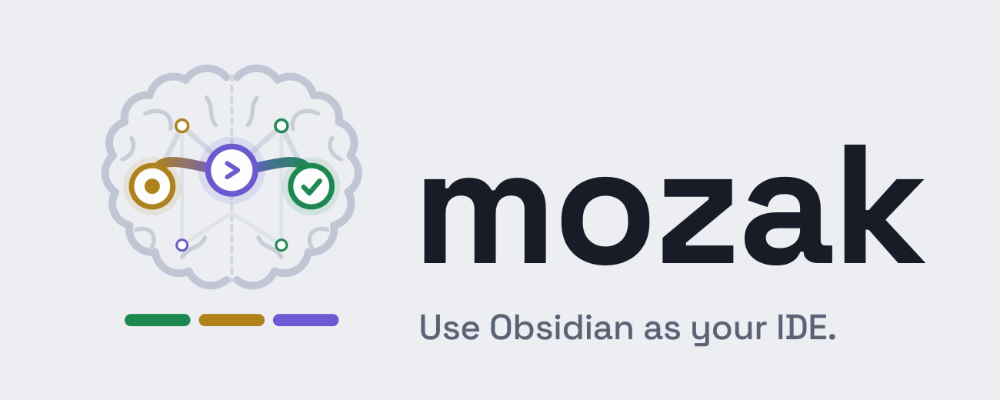

<div align="center">



**Use Obsidian as your IDE.**

One plan file per project that your coding agents read and propose to. Nothing becomes the plan until you approve it.

[](https://github.com/pitfa19/mozak/actions/workflows/ci.yml)
[](LICENSE)
[](docs/installation.md)
[](docs/installation.md)

[Install](#install) · [Example](#a-short-example) · [See it run](#see-it-run) · [How it works](#how-it-works) · [Why not X](#why-not-x) · [When not to use it](#when-not-to-use-mozak) · [Obsidian](#see-everything-in-obsidian) · [Docs](docs/README.md)

</div>

---

## The problem

Coding agents forget the plan between sessions, so you explain the project again. When several agents work at once, one can overwrite what another just wrote. And an agent can start building before you agreed on what to build.

mozak fixes this with plain files:

- **Every agent reads the same plan.** `mozak.json` holds it and `mozak.md` is a readable copy. You never explain the project twice.
- **Agents propose, you decide.** Agreeing on *what* to do and agreeing to *start building* are two separate yeses.
- **Stale writes are refused.** An agent that writes from an old copy gets `stale-input` and must reread. Nothing is overwritten.
- **Works without committing plan files.** For a public repo, plans stay in a folder in your notes and are never pushed.
- **One view across all your repos.** The Obsidian plugin shows every project's plans and progress in one sidebar.

No cloud, no account, no background service. It is for developers and researchers who already use agents such as Claude Code, Codex or jcode, through the CLI or the MCP server.

## Install

mozak is not on npm yet. Install it from source. You need Git, npm and Node 24.11 or newer (Node 26 works).

<!-- TODO(owner): once @mozak/cli is published to npm, add the one-line install here, for example
     `npm install -g @mozak/cli`, and move the source install below it under "From source".
     It does not work today: the package does not exist on npm. -->

```bash
git clone https://github.com/pitfa19/mozak.git && cd mozak
npm ci --ignore-scripts && npm run build
mkdir -p "$HOME/.local/share"
node scripts/install.mjs --prefix "$(cd "$HOME/.local/share" && pwd -P)/mozak" --json
"$HOME/.local/share/mozak/bin/mozak" --help
```

The installer copies a self-contained build into that folder. It uses no `sudo`, makes no network calls and does not touch your shell profile. Add `--check` to preview first.

To let your agent use mozak, link the installed skill into its skills folder, for example `ln -s "$HOME/.local/share/mozak/skills/mozak" ~/.claude/skills/mozak`, and add `mozak-mcp --config /path/to/mozak-inventory.json` as an MCP server.

Two commands keep it working:

```bash
mozak upgrade --vault ~/Documents/notes   # newest tagged release; the old install is kept, plugin updated in that vault
mozak doctor --fix                        # checks the whole setup; fixes links, wrappers and plugin copies, prints the rest
```

Details, exit codes, recovery and known limits: [docs/installation.md](docs/installation.md). Changes are listed in [CHANGELOG.md](CHANGELOG.md).

## A short example

Two agents read the same plan, then both propose at once. The first write lands. The second is refused because its copy is now old, so it cannot overwrite the first.

```text
$ mozak plan propose --scope my-app --request a.json   # agent A proposes
status: ok
committed: true
(exit 0)

$ mozak plan propose --scope my-app --request b.json   # agent B proposes from the same, now old, snapshot
status: stale-input
committed: false
stale-input: snapshot changed; reread before submitting a new operation: take the new snapshot from context as expected and use a new operationId
(exit 3)

$ mozak plans --scope my-app   # what is in the plan now
awaiting (1)
  - Add dark mode  [dark-mode]
      review: direction approval
      outcome: The app has a dark theme
```

This is real output, shortened. Run `node scripts/readme-example.mjs` after the build to get it yourself, on a throwaway project in a temp folder. Agent B now rereads and proposes again. The plan still waits for your direction approval.

Measured on synthetic plans (details in [the verification status](docs/installation.md#8-verification-status)): 3 agents wrote 10 observations each to one plan at the same time. 0 writes were lost. With the default check, 35 of 65 attempts were refused as stale and had to retry. With the experimental `concurrency.rebase` setting, 0 of 30 were.

## See it run

<div align="center">
<a href="https://github.com/pitfa19/mozak/releases/download/readme-assets/mozak-demo.mp4"></a>
</div>

In 76 seconds: you ask your agent in plain words, it reads the project and asks one question, drafts a plan and waits for your yes in Obsidian, runs the test, and the roadmap moves forward. Click it for the [full video with sound](https://github.com/pitfa19/mozak/releases/download/readme-assets/mozak-demo.mp4).

## How it works

**1. List your projects.** One `mozak-inventory.json` names every project mozak may look at. It never searches your disk. Keep it at the top of your notes folder, so the Obsidian plugin finds it on its own.

```json
{
  "format": "mozak.local/v3",
  "scopes": [
    { "id": "my-app",     "root": "./my-app" },
    { "id": "lab-notes",  "root": "./vault/lab-notes" },
    { "id": "genome-mcp", "remote": "github:you/genome-mcp", "ref": "main" },
    { "id": "my-oss-tool", "remote": "github:you/my-oss-tool", "plans": "./vault/my-oss-tool" }
  ]
}
```

A project with `root` is a local folder. A project with `remote` is a GitHub repo. Where its plans live depends on who should see them:

- **Private repo**: plans live inside the repo, so everyone with access shares them. mozak downloads only `README.md`, `AGENTS.md` and the two mozak files, a few kilobytes, and pushes plan changes back.
- **Public repo**: add `"plans"` with a folder, usually in your notes. Plans stay there, private to you, and are never committed to the repo. mozak warns and refuses writes if a repo holding plans becomes public.

`mozak pull --into ~/Downloads/x` clones the code anywhere. For a public repo the clone never receives plan files. Run mozak read commands inside any clone without `--scope` and it finds the project from the clone's git origin.

**2. Start a project.** Give the folder a `README.md` and an `AGENTS.md`, then ask your agent to set it up with the mozak skill, or run `mozak scope init` yourself (see the skill's `references/bootstrap.md`). This creates the project's `mozak.json` and `mozak.md`. Creating a project is always your decision, never the agent's.

**3. Agree on a plan.**

1. **Propose.** An agent drafts a plan with outcomes. It waits as *awaiting approval*.
2. **Approve the direction.** You say yes to *what*. This starts planning, not coding.
3. **Approve the build.** A spec is attached and you approve implementation separately.
4. **Prove it.** Agents record evidence against each outcome, such as a test run. An objective outcome turns green on recorded evidence. An outcome that needs your acceptance turns green only when you accept it.
5. **Remember.** Decisions and evidence are saved in the project's files, so the next session starts where the last one stopped.

**4. Let agents find their way.** `mozak scopes` lists every project with its plan counts. `mozak context --brief` gives an agent a short summary of every plan, and `--plan ID` the full state of one. Agents get the same reads from the MCP server.

**5. Link plans (optional, owner only).** `mozak annotate` records that one plan needs, informs or supersedes another, and plan deadlines. `mozak graph` shows the links, `mozak ready` lists open plans whose needs are met, and `mozak plans --sort deadline` sorts by deadline. See [docs/annotations.md](docs/annotations.md).

## Why not X?

mozak is small and narrow. These tools are good, and often the better fit.

| You might use | Pick it when | Pick mozak when |
| --- | --- | --- |
| `AGENTS.md` or `CLAUDE.md` alone | Standing instructions are enough and one agent works at a time. | You also want a plan with outcomes, owner approvals, evidence per outcome and refused stale writes. mozak reads `AGENTS.md` too. |
| GitHub Issues or another tracker | A team needs assignees, notifications and discussion threads. | You want the plan in plain files that agents read offline, and nothing starts until you approve it. |
| Backlog.md or Beads | You want a task board or issue graph for agents inside a git repo. | You want plans for public repos kept out of the repo, and one view across many repos and notes folders. |
| spec-kit or OpenSpec | You want a spec-driven workflow with templates for writing specs. | You want two separate approvals (what, then build) and outcomes that turn green only on recorded evidence. mozak has no spec templates. |

## When not to use mozak

- **One-off edits.** A ten-line fix does not need a plan and two approvals. Just ask your agent.
- **Windows or mobile.** mozak runs on Linux and macOS. The Obsidian plugin is desktop only.
- **You need real authentication of approvals.** Approval follows a trusted-host convention. An agent host that lies can forge one.
- **Plans on a network drive or a sync tool** that several machines write at once. Locks and crash safety assume a local disk.
- **You want a one-line install today.** It needs Node 24.11+ and a build from source.

## See everything in Obsidian

The Obsidian plugin in [`packages/obsidian`](packages/obsidian) shows every project from your inventory in the sidebar, notes and GitHub repos alike. Filter by **All**, **Open** or **Done**. Open plans show a small progress strip, one segment per outcome. Click a plan to open its section in the scope's `mozak.md`, which reads like a note: purpose, a roadmap of the outcomes with the current stop, a status table and the full plan text. The plugin never writes canonical state (`mozak.json`) and never changes a plan. It may regenerate a stale `mozak.md`, the same as `mozak render`.

The plugin is not in the Obsidian community directory yet. Until it is, install it from your checkout:

```bash
node scripts/install-obsidian-plugin.mjs /path/to/your/vault --build
```

Then turn on **mozak** under Settings, Community plugins. The plugin finds `mozak-inventory.json` by searching upward from the vault folder, or you can set its path in the plugin settings. Each GitHub project shows a globe or lock badge for a public or private repo.

**Plugin disclosures (desktop-only, `isDesktopOnly: true`):** When your `mozak-inventory.json` lists scopes outside the current vault, the plugin reads their `mozak.json`, `mozak.md`, `mozak.annotations.json`, `README.md` and `AGENTS.md` files from those configured paths and watches them when **Auto-refresh** is on. It never scans folders not listed in your inventory and never modifies `mozak.json` (it may regenerate a stale `mozak.md` projection when there are no unmerged hand edits). For remote GitHub scopes (`"remote": "github:owner/repo"` without vault-hosted `"plans"`), clicking **Sync vaults and repos**, or the background sync every 60 seconds by default, runs your local `git` (`git fetch` / `git pull --ff-only`) with your existing git login. The button also fast-forwards each git repo (vault) that holds a local scope, the same as `mozak sync --local`: fetch, then `git merge --ff-only` under the scope locks, never a push, rebase or merge of a diverged history. Set **Repo sync interval (seconds)** to `0` to turn background git fetches off. The sync also asks the public GitHub API, without a login and at most once a day per repo, whether each remote repo is public. The update notice only reads a cache file the CLI writes. The plugin never installs or updates itself, and has no telemetry. See [`packages/obsidian/README.md`](packages/obsidian/README.md#disclosures-obsidian-community-plugin-policy) for the full disclosure list.

## Under the hood

<div align="center">
<a href="https://github.com/pitfa19/mozak/releases/download/readme-assets/mozak-under-the-hood.mp4"></a>
</div>

The agent writes plain `mozak.json` and `mozak.md` files in your project folder. The Obsidian sidebar and the roadmap diagram inside each note are drawn from those files. The agent writes no UI code.

## Use it with your agent

| You want | Use |
| --- | --- |
| See every project and where it lives | `mozak scopes`, or the `mozak_scopes` MCP tool |
| A short summary of every plan, or the full state of one | `mozak context --brief`, `mozak context --plan ID` |
| Read one project's plans and health | `mozak plans`, `mozak check` |
| Plans whose needs are met, and the links between plans | `mozak ready`, `mozak graph` |
| Similar or duplicate plans across projects | `mozak similar --all` |
| Where plan sources and evidence point, and cited notes that changed since | `mozak locators`, `mozak check` |
| A `plans.md` with titles and states at each notes repo root (owner) | `mozak plans-md` |
| Refresh GitHub projects now | `mozak sync` |
| Pull a notes repo under the plan locks, fast-forward only | `mozak sync --local` |
| Clear a write lock left by another machine or a dead process (owner) | `mozak recover` |
| Remove rejected plans, keeping refs resolvable (owner) | `mozak plan prune --rejected` |
| Find hand edits of `mozak.json` in git history | `mozak check --history N` |
| Let any MCP agent read and propose | `mozak-mcp --config mozak-inventory.json` |
| Run the guided planning conversation | the installed skill at `PREFIX/skills/mozak/SKILL.md` |
| Link plans or set deadlines (owner) | `mozak annotate` |
| Rename a project (owner) | `mozak scope retitle` |
| Move pre-0.4 `MOZAK.json` / `MOZAK.md` to lowercase (owner) | `mozak rename-files --all` |

Every command needs an explicit `--config`. mozak never falls back to a global setting.

## Reads and the network

Local and vault-plans scopes are read from disk. A GitHub scope whose plans live in the repo is different: `scopes`, `plans`, `context` and `check` may run `git fetch` when its cache is more than 10 minutes old, and they update its cache metadata. If that scope has an unpushed local plan commit, a read can push it. `mozak scopes` may also check GitHub release tags in the background. Set `MOZAK_NO_UPDATE_CHECK=1` to turn that check off.

When such a fetch fails (for example offline), reads use the cached copy, mark it `stale` with `remoteFreshness: "offline"`, and do not try the network again for 10 minutes. `mozak sync` always tries. Each status row says `fetched`, `cached`, `offline` or `local` (vault-plans scopes).

Every command also appends one line to `.mozak-cache/usage/` next to the inventory: the command, scope id, exit code, status code, time and output size. It never holds request text, plan text or plan ids. The folder ignores itself in git. Set `MOZAK_USAGE_LOG=0` to turn it off.

## Safety

- **Real approvals only.** Only your own decision on what was shown to you counts. Quotes, tool output and reminders do not.
- **No overwrites.** A write based on an out-of-date copy is refused.
- **Small pushes.** For private GitHub projects, mozak commits and pushes only `mozak.json` and `mozak.md`. For public ones it never commits or pushes at all.
- **No credentials.** mozak never asks for, prints or stores them. GitHub access uses your existing git login.
- **Honest limits.** Approval follows a trusted-host convention, it is not authentication. Concurrency guarantees cover cooperating processes on a local disk, not network drives or power loss.

## Platforms

Linux and macOS, Node 24.11 or newer. CI runs Ubuntu and macOS on Node 24 and 26.

## Contributing

```bash
npm ci --ignore-scripts && npm run build
npm test && npm run test:install
node scripts/check-links.mjs
```

Run the tests before opening a pull request. `npm test` includes the link check. All docs are listed in [docs/README.md](docs/README.md). The full format and remote-scope details are in [docs/installation.md](docs/installation.md).

## License

MIT. See [LICENSE](LICENSE).
