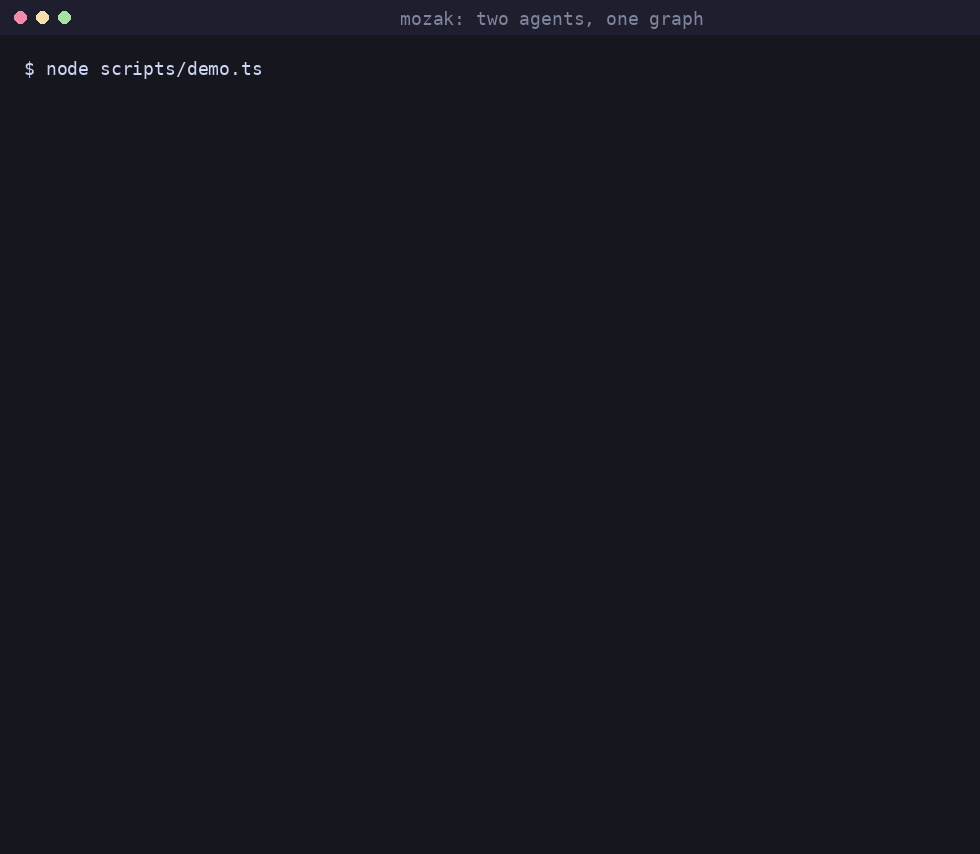

# MOZAK

**One graph over your git repos and your Obsidian notes, readable by you and your AI agents.**

Developers and researchers now work with ideas more than with files. Agents do the typing, and the hard part is keeping a project and the thinking around it in one place that both you and the agent understand. MOZAK is that intermediate layer between git and Obsidian.

## How it is organised

Everything MOZAK manages is a **scope**. A scope is either:

- a **project**: a git repository, or
- a **topic**: an Obsidian folder (it can hold any other notes and subfolders).

Each scope has exactly three files at its root:

| File | For | What it holds |
|---|---|---|
| `README.md` | you | what this is |
| `AGENTS.md` | your agents | how to work here (`CLAUDE.md` is a one-line pointer to it) |
| `MOZAK.md` | both | the **one living plan**, links to other scopes, and translations |

`MOZAK.md` is the only file that points at other scopes. Link a repo by URL, a topic by `[[wikilink]]`. Put all your topics in one git repo and the whole thing is shared across machines and people. Because it is plain Markdown, Obsidian draws the graph for free.

```markdown
---
id: api
kind: project
format: 1
---

## Plan

- [ ] add rate limiting

## Links

- depends-on: [[research]]
- informs: https://github.com/you/web

## Translations
```

Relations are a closed set: `depends-on`, `informs`, `derived-from`, `translates-to`.

## What that makes possible: idea translation

Moving an idea between scopes is where things quietly go wrong. A publishing setup that works in one repo carries hidden assumptions (where it deploys, how it builds) that may not hold in the next.

In MOZAK a translation lists every assumption the idea rests on. It starts with all of them **open**, and it is invalid until the target has re-derived each one. A translation transfers no truth and no authority, it only creates a new claim in the target.

```bash
# draft: every assumption starts [open], and `check` fails
mozak translate --idea "publishing concept" --from research --to site \
  --assumption "deploys from main" --assumption "markdown build step" --write
mozak check ./site        # fails: 2 open assumptions

# after you verify each one in the target
mozak resolve --in site --idea "publishing concept" --n 1
mozak resolve --in site --idea "publishing concept" --n 2
mozak check ./site        # ok
```

## Safe for several agents at once

Agents on different projects update the same graph. Writes through MOZAK take a lock, compare the file's hash against what the agent last read, and rename atomically. A stale write is refused instead of overwriting someone else's edit, and the agent re-reads and retries.

Three real processes appending 120 lines to one file keep all 120, run after run. The same test without the guard lost most of them (8 of 120 survived in the one run I measured). See `packages/core/test/write.test.ts`.



The GIF is rendered from the real output of `scripts/demo.ts`. Only the pacing is simulated, it is not a live recording. Regenerate it with `python3 scripts/render_gif.py`.

Edits made directly in an editor or in Obsidian cannot be blocked, so `check` is the safety net for those.

## Commands

```text
mozak init [dir] --kind project|topic     scaffold the three files, never overwrites
mozak check [dir]                         validate a scope
mozak graph [--config FILE] [--mermaid]   print the graph across scopes
mozak translate ...                       draft a translation, or print the packet an agent works from
mozak resolve ...                         mark an assumption re-derived
mozak audit [dir]                         read only: look at an old .mozak/ and propose a MOZAK.md
```

`graph` reads a small local config that says where your vault and repos live. It never uses the network.

```json
{ "roots": ["/home/you/obsidian", "/home/you/code"] }
```

Save it as `~/.config/mozak/config.json`.

## Try it

Not on npm yet. From a clone:

```bash
git clone https://github.com/pitfa19/mozak && cd mozak
npm install && npm run build && npm test
node --experimental-strip-types --no-warnings scripts/demo.ts   # two agents, one refused as stale, graph stays consistent
node packages/cli/dist/index.js init ./my-scope --kind project
```

Needs Node 22 or newer.

## For agents (MCP)

`mozak-mcp` is a stdio MCP server over the same core. It has five tools and only one of them writes:

| Tool | Does |
|---|---|
| `mozak_graph` | list scopes and how they link |
| `mozak_read` | read a scope's `MOZAK.md` and get a `base_hash` |
| `mozak_check` | validate a scope |
| `mozak_set_plan` | replace the **Plan** section only, with the `base_hash` from `mozak_read` |
| `mozak_translation_packet` | read only: build the work packet for moving an idea |

An agent can never change Links or Translations through MCP. Those are proposals for you. A hostile plan string containing `## Links` is refused, and this is tested.

```json
{ "mcpServers": { "mozak": { "command": "node", "args": ["/path/to/mozak/packages/mcp/dist/index.js"], "env": { "MOZAK_CONFIG": "/home/you/.config/mozak/config.json" } } } }
```

## Status

Early. Working: `init`, `check`, `graph`, `translate`, `resolve`, `audit`, guarded writes, and the MCP server. Not built yet:

- `check` flagging unapproved changes to Links and Translations against git history
- an Obsidian plugin
- publishing to npm

The MCP server is tested over a real stdio session and through a real Jcode session (all five tools discovered, a valid plan write, a stale write refused, and a plan that tried to inject a link refused with the file left byte for byte unchanged). It is not yet tested in Claude Code or Cursor.

Locking is tested on Linux only.

[SPEC.md](SPEC.md) has the full design.

## Prior art

Obsidian MCP servers, basic-memory, and the AGENTS.md standard already cover parts of this. As far as I could find, nothing combines one cross-scope bridge file with translations that must re-derive their assumptions.

MIT licensed.
