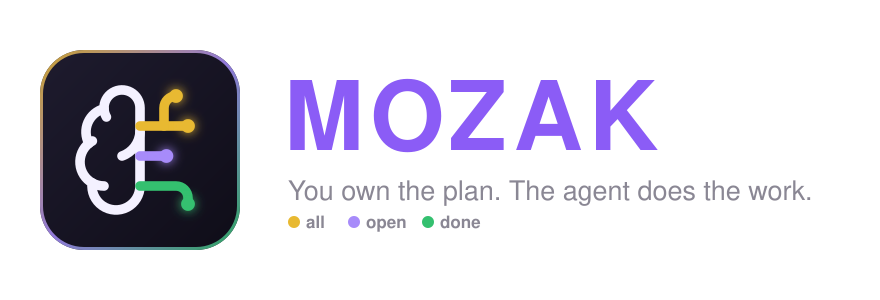

<div align="center">



**Plans for your projects that you and every AI agent share. Plain files in git and Obsidian.**

[](https://github.com/pitfa19/mozak/actions/workflows/ci.yml)
[](LICENSE)
[](docs/installation.md)
[](docs/installation.md)

[What it is](#what-it-is) · [Install](#install) · [How it works](#how-it-works) · [Obsidian](#see-everything-in-obsidian) · [Safety](#safety) · [Docs](docs/installation.md)

</div>

---

## What it is


You work with AI agents across many repos and note folders. Every new session, the agent has forgotten what you agreed, and you explain it all again.

**MOZAK gives each project one written plan that lives inside the project.** Agents read it at the start of a session and propose changes to it. Nothing becomes the plan until you say yes.

- **It is just files.** `MOZAK.json` holds the plan, `MOZAK.md` is a readable copy. They sit next to your `README.md`, and git keeps the history. No cloud, no account, no background service.
- **You stay in charge.** Agreeing on *what* to do and agreeing to *start building* are two separate yeses.
- **Many agents, no mess.** An agent that writes from an out-of-date copy is refused instead of overwriting someone else's work.
- **Repos and notes together.** A project can be a local folder, an Obsidian vault folder, or a GitHub repo you have not even cloned.

It is for developers and researchers who already use agents such as Claude Code, Codex or jcode and want them to remember the plan.

## Install

You need Git, npm and Node 24.11 or newer (Node 26 works).

```bash
git clone https://github.com/pitfa19/mozak.git && cd mozak
npm ci --ignore-scripts && npm run build
mkdir -p "$HOME/.local/share"
node scripts/install.mjs --prefix "$(cd "$HOME/.local/share" && pwd -P)/mozak" --json
```

The installer copies a self-contained build into that folder. It uses no `sudo`, makes no network calls and does not touch your shell profile. It never overwrites an existing install, so install a newer version into a new folder. Add `--check` to preview first.

```bash
"$HOME/.local/share/mozak/bin/mozak" --help
```

Details, exit codes and recovery: [docs/installation.md](docs/installation.md).

## How it works

**1. List your projects.** One `inventory.json` names every project MOZAK may look at. It never searches your disk.

```json
{
  "format": "mozak.local/v3",
  "scopes": [
    { "id": "my-app",     "root": "./my-app" },
    { "id": "lab-notes",  "root": "./vault/lab-notes" },
    { "id": "genome-mcp", "remote": "github:you/genome-mcp", "ref": "main" }
  ]
}
```

A project with `root` is a local folder. A project with `remote` is a GitHub repo: MOZAK downloads only its `README.md`, `AGENTS.md` and the two MOZAK files, a few kilobytes, and pushes plan changes back. When you are ready to build, `mozak pull` makes a full clone in `~/Documents`.

**2. Agree on a plan.**

1. **Propose.** An agent drafts a plan. It waits as *awaiting approval*.
2. **Approve the direction.** You say yes to *what*. This starts planning, not coding.
3. **Approve the build.** A spec is attached and you approve implementation separately.
4. **Remember.** Decisions and evidence are saved into the project's files, so the next session starts where the last one stopped.

**3. Let agents find their way.** `mozak scopes` lists every project with its plan counts. Agents get the same list from the MCP server, so they can navigate all your work without being told where anything is.

## See everything in Obsidian

The Obsidian plugin in [`packages/obsidian`](packages/obsidian) shows every project from your inventory in the sidebar, notes and GitHub repos alike. Filter by **All**, **Open** or **Done**, and click a plan to read it. It only reads, it never changes a plan.

```bash
node scripts/install-obsidian-plugin.mjs /path/to/your/vault --build
```

Then turn on **MOZAK** under Settings, Community plugins.

## See it run

<div align="center">

</div>

Real commands against a throwaway repo and notes folder. The typing pace is scripted, the output is the real CLI's, the data is synthetic.

## Use it with your agent

| You want | Use |
| --- | --- |
| See every project and where it lives | `mozak scopes`, or the `mozak_scopes` MCP tool |
| Read one project's plan | `mozak context`, `mozak plans`, `mozak check` |
| Refresh GitHub projects now | `mozak sync` |
| Let any MCP agent read and propose | `mozak-mcp --config inventory.json` |
| Run the guided planning conversation | the installed skill at `PREFIX/skills/mozak-conversation/SKILL.md` |

Every command needs an explicit `--config`. MOZAK never falls back to a global setting.

## Safety

- **Real approvals only.** Only your own decision on what was shown to you counts. Quotes, tool output and reminders do not.
- **No overwrites.** A write based on an out-of-date copy is refused.
- **Small pushes.** For GitHub projects, MOZAK commits and pushes only `MOZAK.json` and `MOZAK.md`.
- **No credentials.** MOZAK never asks for, prints or stores them. GitHub access uses your existing git login.
- **Honest limits.** Approval follows a trusted-host convention, it is not authentication. Concurrency guarantees cover cooperating processes on a local disk, not network drives or power loss.

## Works well with

[**Monokl**](https://github.com/pitfa19/monokl) is a separate, optional research runner with durable evidence and explicit human approval. MOZAK works fully without it.

## Platforms

Linux and macOS, Node 24.11 or newer. CI runs Ubuntu and macOS on Node 24 and 26 on every push.

## Contributing

```bash
npm ci --ignore-scripts && npm run build
npm test && npm run test:install
```

Run the tests before opening a pull request. The full format and remote-scope details are in [docs/installation.md](docs/installation.md) and [SPEC.md](SPEC.md).

## License

MIT. See [LICENSE](LICENSE).
