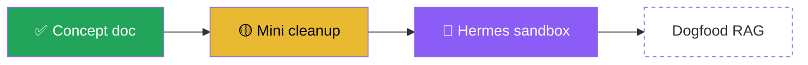

# Spec: readable mozak.md with a roadmap, plugin as pure navigation

Plan: `obsidian-roadmap` (scope `mozak`), accepted revision `a6e44a37-3adf-45a6-b31b-e91942e3191d`.
Owner decisions: direction approved 2026-10-17T22:06:23Z; discussion settled 2026-10-17T23:16:25Z (collapse completed plans, segment-block strips).

## 1. Goal

mozak.md becomes the document the owner reads in Obsidian. Each plan shows its purpose, a roadmap of its outcomes, and the full plan text with headings you can skim. The Obsidian plugin only navigates: it shows progress at a glance and opens the right heading in mozak.md. Canonical state (`mozak.json`), the schema and agent-facing routes do not change.

## 2. Outcome status (core, pure function)

New module `packages/core/src/roadmap.ts`, exported from `index.ts`:

```ts
type OutcomeStatus = "todo" | "evidence" | "done";
interface RoadmapStop { id: string; statement: string; acceptance: "owner" | "objective"; status: OutcomeStatus; current: boolean }
interface Roadmap { stops: RoadmapStop[]; done: number; total: number }
function planRoadmap(state: ScopeState, plan: Plan): Roadmap | null  // null when the plan has no accepted revision
```

Rules (they reuse `outcomeReview` and `boundDecision` from `review.ts`, the checks `plan complete` runs):

- `todo`: `outcomeReview(...).evidenceIds` is empty.
- `evidence`: evidence exists, but the outcome still needs an owner acceptance (`acceptance === "owner"` or open challenges, and no owner acceptance that saw every open challenge).
- `done`: evidence exists and either the outcome is `objective` with no challenges, or an owner `accept-outcome` decision on this accepted revision saw every open challenge. A later supporting observation keeps the outcome `done`. Only a new challenge reopens it.
- `plan complete` is stricter than the roadmap: after a late supporting observation it still needs an owner acceptance bound to the exact current evidence (`boundDecision`). The outcome then also shows an awaiting review entry.
- Completed plans: every stop is `done`.
- `current`: the first stop in array order whose status is not `done`. If every stop is done, no stop is current.
- The function is pure. It reads state and never writes anything.

## 3. mozak.md rendering (`renderBridge`)

The front matter, the title and the three-line generated/data/eligibility header stay. The header gains one line: "Status is computed from mozak.json. Nothing here is clickable or editable."

Plans sort with open and paused first, then awaiting, then completed, then rejected (rejected plans are hidden, as today). Within each group they sort by id. Each non-completed plan renders as:

````md
## Title  `plan-id`
**Open** · 2/5 done · updated 2026-10-17
> Revision awaiting approval: +3 outcomes, constraints changed.     (only when pending is awaiting)

Purpose text.

### Roadmap

| # | Outcome | Status | Accepted by | Criterion |
|---|---|---|---|---|

### Constraints / ### Non-goals / ### Rationale / ### Open questions / ### Sources
````

Details:

- Mermaid labels are the outcome statement cut to its first clause (at most 40 characters, ellipsis). Quotes, brackets and pipes are escaped or stripped, so plan text can never break the diagram or inject mermaid syntax. Node ids are `s1..sN`, never outcome ids.
- When a plan has more than 6 outcomes, the diagram uses `flowchart TB` with 3 stops per row, so it still fits the editor width.
- A plan with no accepted revision (awaiting its first approval) renders its pending content with the label **Awaiting first approval**, a roadmap where every stop is `todo`, and no current stop.
- An accepted plan with an awaiting revision renders its accepted content plus the one-line delta. The delta lists changed field names and outcome count changes, based on `changedFields` from the review subject logic. It never renders the full pending content.
- Completed plans each collapse to one line under `## Completed`: `- ✅ Title (plan-id), completed DATE`.
- Sections that are empty are left out. All plan text goes through the existing `escape()`, so markdown in plan data cannot form headings, links or tasks. Lines starting with `- [ ]` cannot appear.
- Headings are stable (`## Title  \`plan-id\``), so the plugin can link to them.
- The output is deterministic. The same state always gives the same bytes, so the projection hash check keeps working.

## 4. `mozak render` (CLI route)

`mozak render --config FILE (--scope ID | --all) [--json]`. This is an agent route. It writes only the projection.

- For each selected **local** scope: read the scope; if `projectionStatus` is `bridge-stale`, rewrite mozak.md through the existing guarded `publish` path inside the scope lock. Scopes that are `current` are skipped and reported as current.
- `bridge-conflict` is never overwritten. It is reported, and the owner fixes it with `projection repair`.
- Remote scopes are skipped and reported as `remote-skipped`. Their projection is regenerated by their next sync or write.
- `mozak.json` is never opened for writing. The JSON output reports a per-scope result: `rendered` | `current` | `conflict` | `remote-skipped` | `failed`.
- Exit codes follow the existing conventions: 0 for full success, 6 for partial coverage.

Why a renderer change makes bridges stale: when the expected render changes, old bridges no longer match. Today `projectStatus` then reports `bridge-conflict` (their hash is not `previousBridge`). Fix: also treat the bridge as stale when it matches the bytes the **legacy v3 renderer** would produce for the same state. The old renderer is kept as `renderBridgeLegacy`, used only for this comparison. This way old-format bridges count as stale, never as a conflict, while files someone edited by hand still count as a conflict.

## 5. Obsidian plugin

- Delete `PlanView`, `PLAN_VIEW_TYPE`, its registration and its styles. On load, detach any open leaves of the old type.
- Plan rows: open plans show a segment strip, one block per outcome, colored by status (done green, evidence gold, current purple outline, todo faint), followed by `done/total`. Awaiting, paused and rejected keep their text label. The data comes from `planRoadmap`, added to `PlanVM` in `model.ts`.
- Clicking a plan opens the scope's mozak.md at heading `Title  \`plan-id\`` (`openLinkText` with a `#heading` subpath). For remote or out-of-vault scopes, the plugin opens the file externally as today.
- On refresh, for each local scope whose `projectionStatus` is `bridge-stale`, the plugin calls core's render function. That is the same function `mozak render` uses, so there is no separate write code in the plugin.
- README and the plugin manifest description say: "Never writes canonical state (mozak.json). May regenerate mozak.md projections."

## 6. Tests

- `packages/core/test/roadmap.test.ts`: all three statuses, owner vs objective acceptance, challenges, the current-stop rule, completed plan, and a plan with no accepted revision.
- `scope-store.test.ts`: deterministic rich render. Mermaid escaping, including a hostile title that contains `"]-->x[`, backticks, `- [ ]` and `#`. The completed plan collapses to one line. The pending delta is one line. A legacy-format bridge counts as stale, a hand-edited bridge counts as a conflict.
- `render` route test: stale scopes are rewritten, current scopes are skipped, a conflict is refused, `mozak.json` bytes are identical before and after.
- `packages/obsidian/test/model.test.ts`: the strip view model, the heading link target, and a check that no PlanView export remains.
- `npm run build && npm test` stays green.

## 7. Rollout (after tests pass)

Version-skew hazard: mutations refuse unless the projection is `current` (`scope-store.ts` line 305). An **old** CLI reading a **new-format** mozak.md sees `bridge-conflict` and blocks every write to that scope. So no real vault scope may be rendered in the new format while the installed CLI is still old.

1. Implementation and tests run in the repo against temp fixtures only. Real scopes are not touched.
2. For owner preview, render copies of 2-3 real scopes (`creations`, `personal`, `mozak`) into the gitignored `scratch/preview/` folder, plus a throwaway inventory pointing at those copies. Open them in Obsidian from there. The real scopes stay untouched.
3. The CLI upgrade is a separate owner step and is outside these bounds. The installer refuses an existing prefix, so the upgrade means a fresh prefix (e.g. `~/.local/share/mozak-v3`) and repointing `~/.claude/skills/mozak-conversation`. That is an installation plus a global config change, so the owner does it or approves it separately.
4. Only after the installed CLI is the new version: `render --all` against the real inventory, with `mozak.json` hashes checked before and after, then the plugin is reinstalled into the vault (`node scripts/install-obsidian-plugin.mjs ~/Documents/obsidian --build`). Final owner review of `rich-bridge` and `plugin-navigation`.

## 8. Limitations

- Obsidian's mermaid theme may override `classDef` colors in some themes. The status emoji in labels stay readable without color.
- Remote scopes show the new format only after their next sync or write.
- The roadmap is linear (array order). Branching with `dependsOn` is out of scope.
